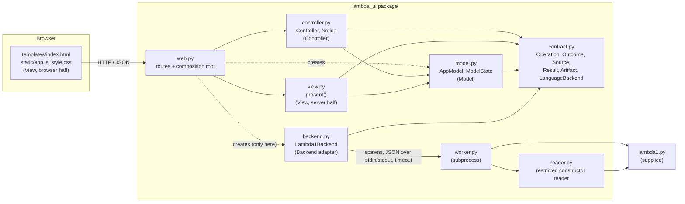
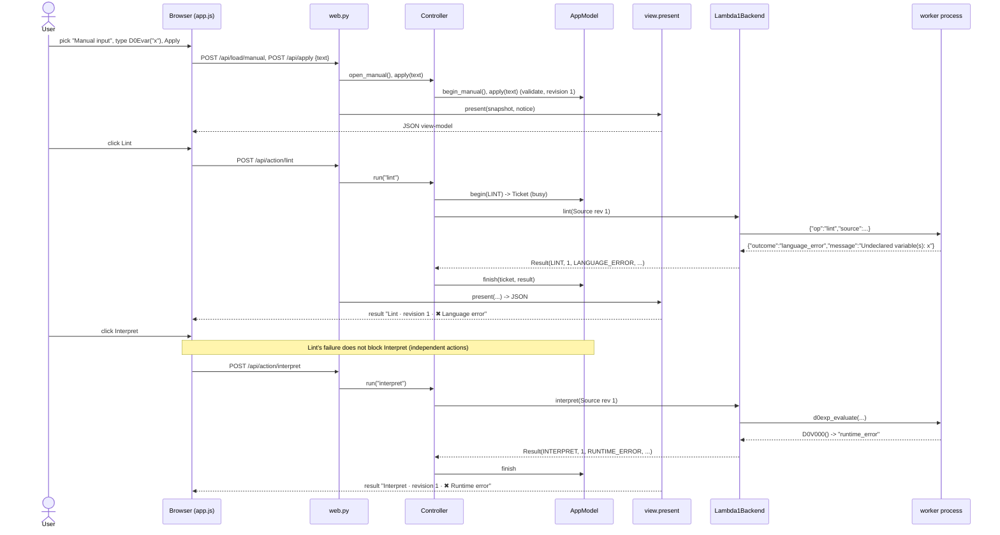

# ARCHITECTURE.md

A local, single-user web front-end for LAMBDA built with Model–View–Controller. Flask is the only
framework; it is used for HTTP routing and templating and nothing else.

## 1. Component diagram (actual modules and dependencies)

Arrows mean "imports / calls". Two properties matter and are enforced by `tests/test_architecture.py`
(import-graph checks):

* `model`, `controller` and `view` never import Flask, `lambda1`, `reader`, `worker` or `backend`.
  The controller sees a backend only as the `LanguageBackend` protocol from `contract.py`.
* Only `web.py` constructs the real backend (`Lambda1Backend`); only `reader.py` and `worker.py`
  touch `lambda1`. The browser code contains no language logic.

## 2. Responsibility table

| Role | Files / classes / functions | Owns | Must not |
| --- | --- | --- | --- |
| **Model** | `model.py`: `AppModel`, `ModelState`, `RuleViolation`, `Ticket` | Applied source and name, **revision counter**, unapplied draft, busy flag, results of the current revision, generated-code artifact; all state rules: validation (empty / size / UTF-8), no source replacement or action while edits are unapplied or an operation is running, new revision clears results and artifact, Execute only with an artifact of the current revision, failed recompile invalidates the artifact, stale results dropped | Know HTTP, HTML, Flask, or how to parse/interpret LAMBDA |
| **View (server)** | `view.py`: `present(state, notice)` | Turns an immutable `ModelState` into display data: source label, status sentence, button list with enabled flag and reason, result titles (`Lint · revision 3 · ✖ Language error`), the Execute explanation | Call the backend or analyse programs |
| **View (browser)** | `templates/index.html`, `static/app.js`, `static/style.css` | Renders the view-model (using `textContent`, so text is never parsed as HTML); forwards clicks, typing and file choices to the HTTP endpoints; local convenience (disable buttons immediately while a request is in flight) | Contain language analysis; decide what is allowed (the model re-checks every rule) |
| **Controller** | `controller.py`: `Controller` (`load_canned`, `load_upload`, `open_manual`, `edit`, `apply`, `discard`, `run`), `Notice` | Translates a user intention into model calls; for actions: `model.begin()` → backend call → `model.finish()`; converts backend exceptions or malformed results into `BACKEND_FAILURE` results so the UI can never get stuck busy | Touch HTTP objects or HTML; know which backend it was given |
| **HTTP binding / composition root** | `web.py`: `create_app`, routes | One route → one controller call → `present()` → JSON; builds model, backend, controller; CSP and cache headers; reads canned examples from `samples/` | Hold state or rules |
| **Backend adapter** | `backend.py`: `Lambda1Backend`; `worker.py`; `reader.py` | The only place that knows how tools are invoked: runs real Lint (`d0exp_fvset`) and Interpret (`d0exp_evaluate`) in a worker process with a timeout; placeholders for Type-check, Compile, Execute | Be imported by model, controller or view |
| **Contract** | `contract.py` | Shared vocabulary: `Operation`, `Outcome`, `Source`, `Result`, `Artifact`, `LanguageBackend` | Import anything from the app |

## 3. Backend contract

Conceptual operations, implemented as methods of `contract.LanguageBackend`:

| Operation | Signature | Result operation / revision |
| --- | --- | --- |
| lint | `lint(source: Source) -> Result` | `LINT`, `source.revision` |
| interpret | `interpret(source: Source) -> Result` | `INTERPRET`, `source.revision` |
| typecheck | `typecheck(source: Source) -> Result` | `TYPECHECK`; must return `NOT_IMPLEMENTED` until a real checker exists |
| compile | `compile(source: Source) -> Result` | `COMPILE`; on success carries an `Artifact`; today `NOT_IMPLEMENTED` with no artifact |
| execute | `execute(artifact: Artifact) -> Result` | `EXECUTE`, `artifact.revision`; only ever called with a model-approved artifact |

`Source(name, text, revision)` is an immutable applied source. Every `Result(operation, revision, outcome, message, artifact=None)`
echoes the operation and the source revision it was computed for; the controller rejects (as a
backend failure) a result whose operation or revision does not match the request, and the model
silently drops a result whose revision is no longer current.

| `Outcome` | Meaning | Examples |
| --- | --- | --- |
| `SUCCESS` | The operation completed with nothing wrong | Lint: no free variables; Interpret: `D0Vint(arg1=42)` |
| `INPUT_ERROR` | The text is not a valid constructor expression | `D0Eint(`, `open("f")`, `D0Eint("a")` |
| `LANGUAGE_ERROR` | Valid input, but Lint found undeclared variables (names sorted, deterministic) | `Undeclared variable(s): x, y` |
| `RUNTIME_ERROR` | Valid input; evaluation failed or returned the `D0V000()` error sentinel (also inside a pair) | division by zero, type error, unbound variable |
| `BACKEND_FAILURE` | The tool crashed, timed out or is unreachable; says nothing about the program | worker timeout, exception |
| `NOT_IMPLEMENTED` | Placeholder operation | Type-check, Compile |

**Artifact contract (for Execute).** `Artifact(revision, kind, payload)`: `revision` is the source
revision it was compiled from, `kind` names the format (e.g. `"python"`), `payload` is the generated
code as text. Only a *successful* `COMPILE` result may carry one. The model keeps at most one
artifact, drops it when a new revision is created, and replaces/drops it on every later Compile
(a failed recompile leaves *no* artifact). Execute is enabled only while the stored artifact's
revision equals the current revision, and `begin(EXECUTE)` hands that stored artifact to the
backend, so Execute consumes exactly what Compile produced and never recompiles.

**Execution bounds.** Lint and Interpret run in a fresh worker process with a default timeout of
5 s (`LAMBDA_UI_TIMEOUT`, seconds); on timeout the process is killed and a `BACKEND_FAILURE` is
reported. Inside the worker the recursion limit is 6000, output is truncated at 20 000 characters,
and source text is limited to 64 KiB.

## 4. Trace: Load source → Lint → Interpret (with an undeclared variable)

Numbered version:

1. The user chooses **Manual input**. `Controller.open_manual` → `AppModel.begin_manual` opens a blank draft; the applied source (if any) stays.
2. The user types `D0Evar("x")` and presses **Apply changes**. The browser posts the text; `Controller.apply` → `AppModel.apply` validates it (non-empty, ≤ 64 KiB), creates revision 1, clears results/artifact.
3. The user presses **Lint**. `Controller.run("lint")` → `AppModel.begin(LINT)` checks: source applied, no unapplied edits, not busy; sets busy.
4. The controller calls `backend.lint(Source("Manual input", 'D0Evar("x")', 1))`. The adapter starts the worker, which reads the text with the restricted reader and calls `d0exp_fvset` (no evaluation). The free set is `{"x"}`, so the worker answers `language_error`, "Undeclared variable(s): x".
5. `AppModel.finish` stores `Result(LINT, rev 1, LANGUAGE_ERROR, …)` and clears busy; the view renders `Lint · revision 1 · ✖ Language error` with the names.
6. The user presses **Interpret** (allowed: Lint is advisory). The worker evaluates with `ENVnil()`, receives `D0V000()` and reports `RUNTIME_ERROR` ("evaluation produced the error value D0V000()").
7. The user edits the source to `D0Elet("x", D0Eint(1), D0Evar("x"))` and applies it: revision 2, old results cleared. Lint now returns `SUCCESS`: "No free variables found."

## 5. Two design decisions and their tradeoffs

**D1. The controller, not the model, coordinates backend calls (model is a passive state machine with `begin`/`finish`).**
*Why:* the model can then be unit-tested with no backend at all and stays free of tool, process and
timeout concerns; the controller is the one place that talks to a replaceable `LanguageBackend`,
which is what lets a test backend be substituted. *Cost:* the "busy → done" protocol is split in
two calls, so a controller that forgot `finish` would leave the model busy (mitigated: `run`
always reaches `finish`, including when the backend raises). Letting the model call the backend
would give a simpler single entry point but would tie rule-checking to tool invocation and make
model tests need fakes.

**D2. Lint and Interpret run in a short-lived worker subprocess instead of an in-process thread.**
*Why:* the assignment requires that a nonterminating program cannot leave the app permanently
busy. Python threads cannot be killed; a process can, so a timeout really stops the work, and a
crash or memory blow-up in the interpreter cannot take the web server down. *Cost:* about 55 ms
start-up per call (measured on the development machine), JSON as the wire format between adapter and worker (values come back as text,
not objects), and a second process to document. Alternatives considered: `ThreadPoolExecutor`
with a timeout (abandoned threads keep burning CPU) and `multiprocessing` (heavier pickling
surface, platform-dependent start methods).

Smaller decision, stated for completeness: the unapplied *draft* is kept in the model (the browser
syncs it 200 ms after typing and flushes before actions) so the "no actions or replacement while
edits are unapplied" rule is enforced server-side, not just by greying buttons. Cost: one extra
request per pause in typing.

## 6. Replacing the placeholders

* **Type-checking.** Add a checker module and have `Lambda1Backend.typecheck` call it (in the worker
  like Lint, so it gets the same timeout). It returns `SUCCESS` with the inferred type text, or
  `LANGUAGE_ERROR` with the diagnostic. No model, controller or view change is needed: results are
  already keyed by operation and revision, and the button already exists.
* **Compilation.** Implement `Lambda1Backend.compile` (or a new `LanguageBackend`) to return
  `Result(COMPILE, rev, SUCCESS, "…", artifact=Artifact(rev, kind, payload))`. Failure returns
  `LANGUAGE_ERROR`/`BACKEND_FAILURE` with no artifact. The model installs the artifact only for a
  successful Compile of the current revision.
* **Execute.** As soon as a compile has produced an artifact, `ModelState.availability[EXECUTE]`
  becomes enabled and the view enables the button, with no view change. Pressing it makes the model
  hand the *stored artifact* to `backend.execute(artifact)`, so the code that ran is exactly what
  Compile produced for that revision. Editing/applying/loading creates a new revision and drops the
  artifact (Execute disables again); a failed recompile also drops it. Execute therefore never
  recompiles and never falls back to interpretation.
* **Real compiler as an extension (not part of the required functionality).** A compiler that is
  an external program/service is wrapped in a new adapter class implementing the same five methods;
  `web.py` selects it in one line. Its availability problems map to `BACKEND_FAILURE`, so the UI
  already tells students "the tool failed, your program was not judged".
